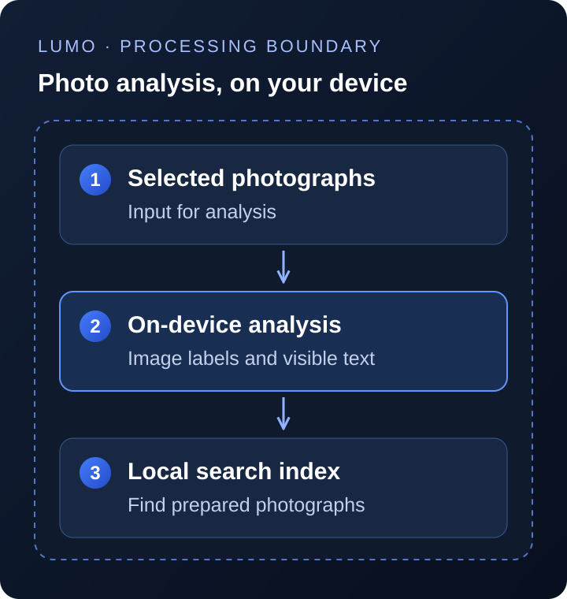
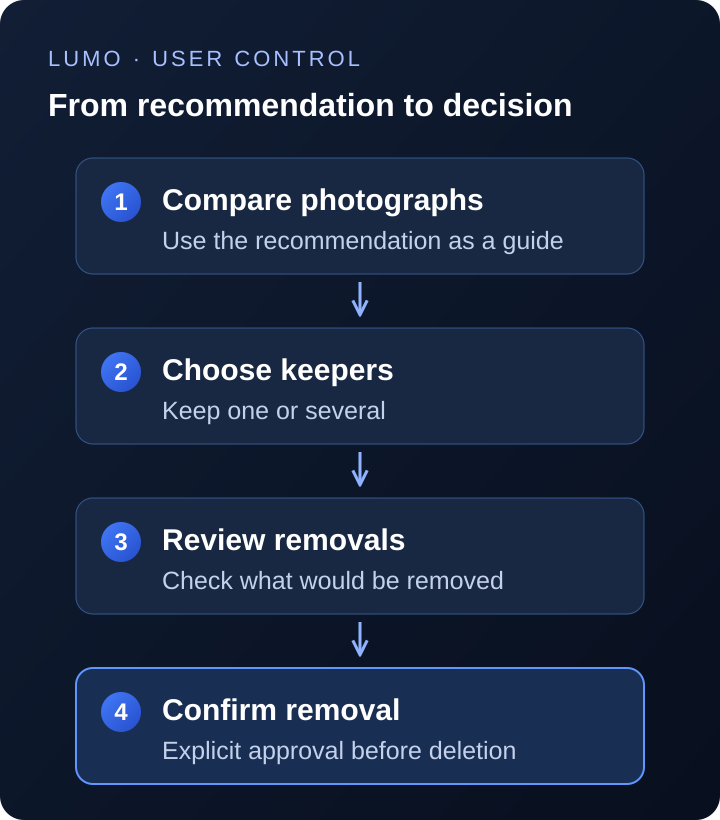

A photo library gives a mobile app access to something unusually personal.
It can contain family moments, work documents, location clues and pictures
someone would struggle to replace. Helping organise that library means
handling both sensitive information and decisions with lasting consequences.

[Lumo](https://lumo.duniaops.com/) is DuniaOps's own photo application,
available on iPhone and iPad. It helps people compare similar photographs,
choose the frames they want to keep, review removals and find prepared photos
again. This is a first-party account of the product and its engineering,
rather than a client delivery story.

For a business commissioning a mobile app, Lumo provides a concrete way to
examine three questions: where does sensitive processing happen, who controls
the result, and what happens when an action could remove something valuable?

## Define the boundary around sensitive processing

Lumo performs photo analysis and indexing on the device. The project's search
implementation uses Apple's Vision framework for image classification and
recognising visible text. Those observations contribute to a local catalogue
that helps people find photographs by what they remember about them.

*Photo-analysis flow, simplified from the project implementation. Optional
service connections are separate from this diagram.*

The important boundary is specific: photographs are not uploaded for this
analysis. That describes the data path for a particular operation. It does
not imply that every feature in the application works without a connection.
Lumo's [privacy policy](https://lumo.duniaops.com/privacy) separately explains
purchases, sharing and optional place lookup.

For another mobile product, the useful starting point is to name each
operation and its inputs. A search feature might need a local label; a
payment needs a transaction; an export needs the selected output. Treating
these as separate flows makes it easier to explain what leaves the device
and to review whether that transfer is necessary.

Device-side processing also leaves engineering work to do. A local index has
a lifecycle, consumes storage and needs a way to be rebuilt. In Lumo's
project, the search catalogue is rebuildable data. Clearing that catalogue
and removing an original photograph are separate responsibilities. Keeping
that distinction explicit makes maintenance actions easier to reason about.

## Give recommendations a clearly limited role

Lumo can recommend a frame using technical image quality, while the user
chooses which photographs to keep. They can choose a different favourite or
retain several images from the same group.

A technically sharper photograph cannot settle which moment matters most.
Someone may value a particular expression or want several frames for different
purposes. An application can help compare the options while leaving that
judgement with the person who understands the context.

This gives a mobile team a useful acceptance question: can the user make a
reasonable choice that differs from the recommendation? A review interface
needs to support that choice directly. Showing a suggested result is only
part of the workflow; selecting alternatives and understanding the current
selection matter too.

The same question applies to business tools that suggest a document category,
prioritise a work item or flag a possible duplicate. The scope of the
recommendation should be clear enough for someone to accept or correct it.

## Make removal an explicit decision

Photo organisation has a consequential transition: moving from reviewing
suggestions to removing assets. Lumo asks the user to confirm removals, and
Photos library deletions use the system's Photos workflow and Recently
Deleted recovery route.

*A simplified review flow. Reviewing a recommendation does not itself
authorise removal; this diagram is an explanation rather than an app screen.*

The project source also shows explicit removal operations and confirmation
state, with regression tests for a selection containing no keepers. That edge
case matters: zero selected photographs still needs a defined, understandable
outcome. Reviewing a selection should not leave the meaning of the next
action ambiguous.

For an app handling valuable records, the review should cover more than a
successful demonstration. What can the person see before confirming? Can
they cancel? Does the interface distinguish the selection from the items
proposed for removal? What recovery mechanism actually applies to that
storage system?

These are practical questions for product design and testing. A confirmation
dialogue is one part of the answer; the preceding selection, the operation
itself and the resulting state need to agree.

## Explain optional connections at the point of use

Local processing and optional network features can coexist, provided their
boundaries are explained accurately. Lumo's documented place-lookup flow asks
for a choice before using Apple's geocoding service. The policy describes
the limited place information involved and the local search capabilities
that remain available if the person declines.

That is a more useful level of explanation than asking someone to interpret
a broad privacy slogan. It ties a decision to a purpose: what information is
needed, which service receives it and what happens without that connection.

For a commissioned application, this can become a straightforward review
exercise. Take each optional connection in turn and follow it through the
interface, implementation and privacy explanation. The description should
match the operation people are actually being offered.

## Keep the case study within the evidence

Lumo is a real DuniaOps product with a public
[App Store listing](https://apps.apple.com/gb/app/lumo-photo-culling/id6799718934).
It provides concrete material for discussing data boundaries, user judgement
and consequential actions. This account does not establish a quantified
improvement in review speed, recommendation accuracy or commercial results.
Those would require their own measurements.

The useful proof is more specific: a working product has identifiable
processing boundaries, a defined role for recommendations and a removal
workflow that can be examined in detail. For someone selecting a development
partner, those details create better questions than a list of technologies
alone.

## Apply the same questions to your mobile project

Before committing to a feature list, identify the sensitive inputs, the
decisions an app will suggest and the actions that change or remove data.
Then walk through an ordinary use case, a declined permission and a cancelled
operation. Each should have an outcome the team can explain and test.

Our [Mobile App Development service](/services/mobile-app-development)
is the starting point for discussing an iOS or mobile product with those
constraints. If you have a workflow in mind,
[tell us about the project](/?service=mobile&from=blog#contact), including the
data it handles and the decisions people need to remain in control of.
